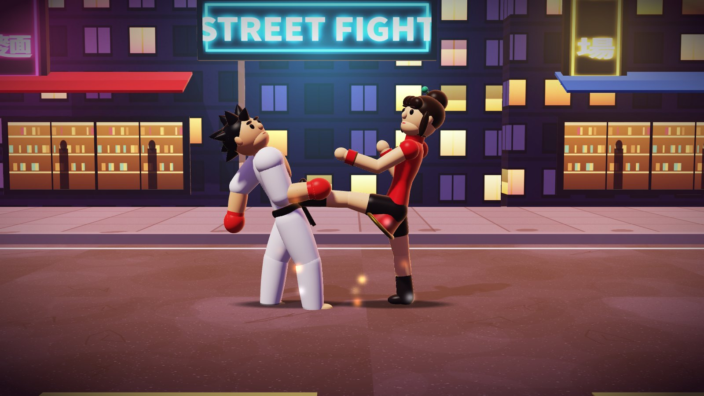

# 街頭格鬥 Street Fight 3D

一款以 Kotlin 寫成的 Android 3D 高畫質街頭格鬥遊戲，不需要任何圖檔或音檔——模型、貼圖與音效全部由程式產生。
A 3D HD Android street-fighting game written in pure Kotlin, with no image or audio assets — every model, texture and sound is generated in code.

📖 **說明網站 Docs:** https://pppp20250712.github.io/street-fight/
🎮 **瀏覽器試玩 Play in browser:** https://pppp20250712.github.io/street-fight/play/



## 特色 Features
- 兩位角色 Two fighters: **RYO 龍**（力量型 Power · 氣功彈 Ki Blast）與 **MEI 美玲**（速度型 Speed · 鳳凰連腳 Phoenix Kicks）
- **3D 高畫質 3D HD**：立體角色模型、即時陰影、霓虹與路燈光源、夕陽輪廓光、4× MSAA、色調映射 Modelled fighters, shadow mapping, neon & street-lamp lights, sunset rim light, 4× MSAA, filmic tone mapping
- 電腦對手三種難度 CPU opponent with 3 difficulty levels
- 三戰兩勝、60 秒回合、K.O.、連段、打擊停頓 Best of 3, 60-second rounds, K.O., combos, hit-stop
- 合成音效 Synthesized sound effects
- 觸控搖桿與按鈕，並支援鍵盤 Touch joystick + buttons, plus keyboard support
- 網頁版（WebGL2）與 Android 版（OpenGL ES 3.0）共用同一套著色器與模型 The web (WebGL2) and Android (OpenGL ES 3.0) versions share the same shaders and models

## 建置 Build
1. 用 Android Studio 開啟此資料夾 Open this folder in Android Studio
2. Sync Gradle，然後 ▶ Run（選 `app`）Sync Gradle, then ▶ Run (select `app`)

```
./gradlew assembleDebug
```

需要 Requires: Android SDK 37 · minSdk 34 (Android 14) · OpenGL ES 3.0

## 操作 Controls
| 動作 Action | 觸控 Touch | 鍵盤 Keyboard |
|---|---|---|
| 移動 Move | 左搖桿 Left joystick | ← → / A D |
| 跳 / 蹲 Jump / Crouch | 搖桿上 / 下 Joystick up / down | ↑ ↓ / W S |
| 拳 / 腳 / 必殺 Punch / Kick / Special | 右側按鈕 Right buttons | J / K / L |
| 防禦 Block | 按住後方 Hold back | 按住後方鍵 Hold back |

## 程式 Code
| 檔案 File | 內容 Purpose |
|---|---|
| `FightActivity.kt` | GLSurfaceView（3D 場景）上疊遊戲／HUD 畫面 GL scene with the game/HUD view on top |
| `GameView.kt` | 遊戲迴圈、回合流程、碰撞、HUD、輸入 Game loop, rounds, hits, HUD, input |
| `Renderer3D.kt` | OpenGL ES 3 繪製器：陰影、燈光、角色模型、特效 Renderer: shadows, lights, fighter rig, effects |
| `Gfx.kt` · `StageTex.kt` | 矩陣、幾何、攝影機、程式貼圖 Math, geometry, camera, procedural textures |
| `Fighter.kt` · `Data.kt` · `AI.kt` · `Sfx.kt` | 角色狀態機、招式數值、電腦 AI、音效 Fighter states, frame data, CPU AI, sound |

遊戲程式位於 Game code is in `app/src/main/java/streetfight/`；說明網站與網頁 3D 版位於 the docs site and browser 3D version are in `docs/` and `docs/play/`.
